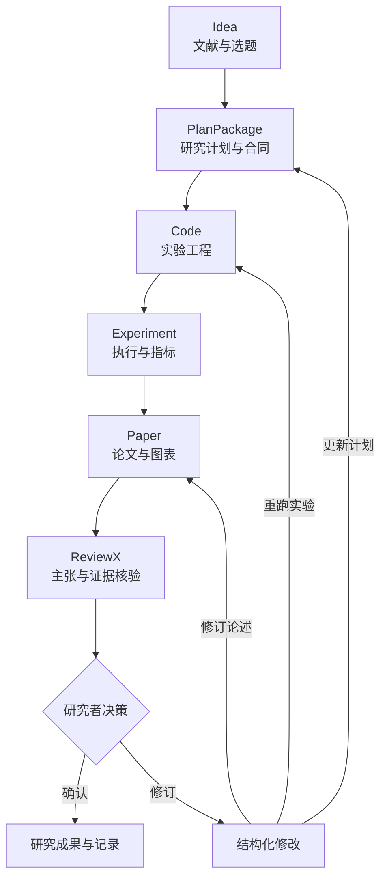
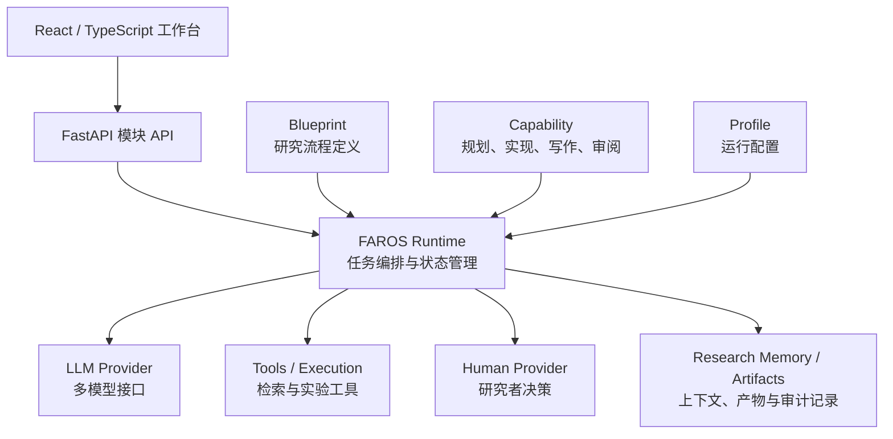
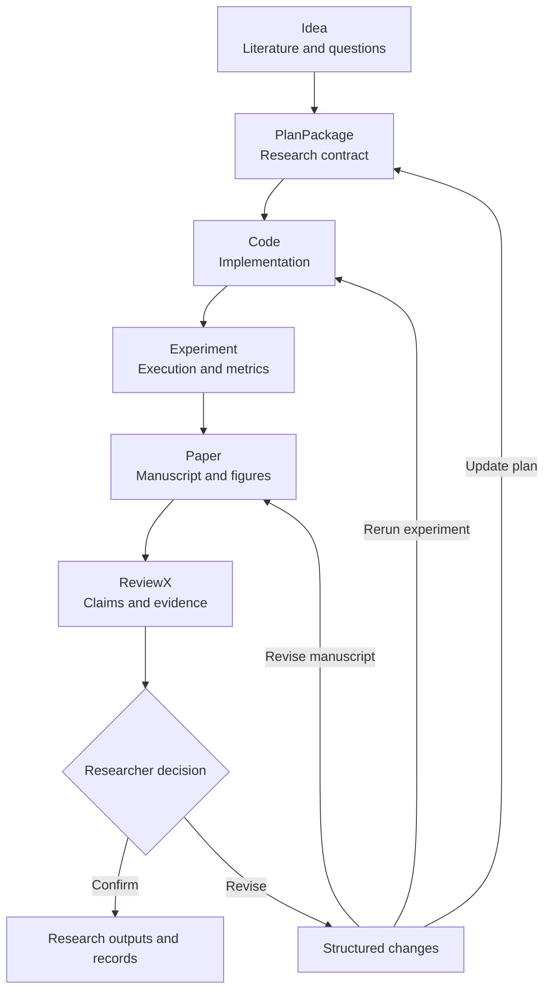

<p align="center">
  
</p>

<h1 align="center">智塔 · FAROS</h1>

<p align="center">
  <strong>Foundation AutoResearch Operating System</strong><br />
  面向多模型、人机协同与多智能体协作的 AI Scientist 科研系统<br />
  A collaborative AI Scientist system with configurable models, coordinated agents, and human oversight
</p>

<p align="center">
  <a href="https://github.com/OpenNSWM-Lab/FAROS/stargazers"></a>
  <a href="#模型接入"></a>
  <a href="#三项核心机制"></a>
  <a href="#科研闭环"></a>
</p>

<p align="center">
  <a href="#中文">中文</a> &nbsp;|&nbsp;
  <a href="#english">English</a> &nbsp;|&nbsp;
  <a href="#快速开始">快速开始</a> &nbsp;|&nbsp;
  <a href="#quick-start">Quick Start</a> &nbsp;|&nbsp;
  <a href="deploy/README.md">部署 / Deployment</a>
</p>

> **从研究问题到可检验结果，让每一轮研究都有据可循。**<br />
> Connect research questions, executable experiments, and verifiable findings in one continuous workflow.

---

# 中文

## 项目简介

FAROS 是一个将**研究选题、文献检索、实验规划、代码实现、结果分析、论文写作与证据审计**连接起来的多智能体科研系统。研究者提出问题、确认关键条件并决定下一步；智能体协同完成资料整理、方案生成、实验实现与审阅，将来源、运行记录和修改依据组织为可追溯的研究过程。

系统以三项机制贯穿科研流程：**科研合同统一执行条件，ReviewX 核验主张与证据，反馈编译将审查发现转化为可执行修订**。模型通过统一 Provider 层接入，研究流程、工具和数据源可以分别配置与扩展。

### 适用场景

| 研究任务 | 在 FAROS 中开展的工作 |
| --- | --- |
| 文献调研与研究选题 | 检索相关文献、整理已有方法与研究空缺，形成有来源支撑的候选方案 |
| 算法研发与论文复现 | 将研究计划转成代码项目，运行实验并保存配置、日志和评价指标 |
| 数值建模与实验优化 | 组织模型、变量、预算和对照实验，根据结果修订下一轮条件 |
| 科学主张与证据核验 | 关联论文论述、引用、原始指标与图表，检查一致性并定位问题 |
| 研究协作与成果交接 | 汇总计划、代码、结果、论文和审核记录，支持历史恢复与持续迭代 |

## 三项核心机制

| 机制 | 如何工作 | 为研究带来的价值 |
| --- | --- | --- |
| **科研合同** | 通过 `PlanPackage` 和结构化研究对象组织目标、假设、变量、资源约束、产物与验收条件，检查字段和证据引用 | 规划、实现与审阅共享明确的研究条件，便于核对执行过程 |
| **ReviewX 证据审计** | 抽取研究主张，关联文献、实验指标和图表；结合程序核验与模型审阅检查错配风险 | 结论能够追溯到依据，问题能够定位到具体证据与研究环节 |
| **反馈编译与迭代** | 将发现整理为包含目标字段、原值、新值、理由和证据的修订；校验后交由研究者批准，再进入相应流程 | 一条审查意见可以驱动计划更新、实验重跑或论述修订，并接受下一轮核验 |

**人的判断贯穿闭环。** 研究者可以检查原始证据、采纳或调整修订建议，在计划批准和结果确认等关键节点作出决策。模型负责提出和解释方案，执行工具记录实际发生的过程，ReviewX 将反馈与新的研究证据连接起来。

## 科研闭环



| 阶段 | 核心能力 | 主要产物 |
| --- | --- | --- |
| Idea | 选题辅助、文献检索、语义过滤、深读、创新性与可行性审查 | 证据支持的候选研究创意 |
| PlanPackage | 假设细化、变量设定、任务拆解、质量检查、人工批准 | 可执行且可验证的研究计划 |
| Code | 代码检索、工程生成、沙箱执行、静态与动态评估、修复 | 实验项目与执行记录 |
| Experiment | 指标采集、数据集上传、结果比较、图表生成 | 结构化实验数据与图表 |
| Paper | Brief、Outline、分节写作、引用管理、LaTeX/PDF 生成 | 与计划和实验关联的论文工程 |
| ReviewX | 主张抽取、证据对齐、图文核验、风险分析、修订与人工反馈 | 审阅报告、结构化修订和反馈记录 |

### 工作台体验

- **任务可接续：** 选题与计划生成支持后台任务和状态轮询，可从研究历史恢复查看。
- **证据可追溯：** 关联计划、项目、运行、实验、论文与审阅记录，支持定位来源和比较结果。
- **模型可配置：** 按账号管理 Provider、API 地址、模型名称和凭据，适配不同研究任务。
- **界面可切换：** 提供中英文、明暗主题与响应式布局，支持日常研究和团队协作。

## 模型接入

FAROS 使用统一 Provider 接口组织模型调用。仓库包含 OpenAI、Anthropic、DeepSeek、Moonshot、智谱、MiniMax 等适配配置，并支持自定义 Base URL 和模型名称。

| 接入方式 | 配置方式 |
| --- | --- |
| 内置 Provider | 在设置中选择服务，填写 API Key、模型名称及需要覆盖的 Base URL |
| OpenAI-compatible 服务 | 使用 `openai` 配置项连接兼容的 Chat Completions 接口，填写服务实际提供的模型 ID |
| 自建模型服务 | 将兼容接口的 Base URL 指向自建端点，并配置其鉴权信息与模型 ID |
| 新协议或专用工具 | 扩展 Provider 适配层，通过运行时能力接口接入研究流程 |

**按任务选择模型能力。** 计划与修订生成需要稳定的结构化输出；代码任务需要代码生成能力；图表视觉审计需要支持图像输入的模型。上下文长度、延迟、预算和具体参数由所选服务决定，可先使用设置页的连接测试确认基本调用，再验证目标研究任务。

## 系统架构



流程由 `Blueprint` 定义，具体工作由 `Capability` 承担，运行配置由 `Profile` 组织，模型、工具、执行与人工节点通过 `Provider` 接入。模块间使用结构化研究对象交接，将研究意图、执行状态和证据引用保留在同一流程中。

```text
FAROS/
├── backend/
│   ├── app/faros/                 # 流程运行时、能力注册与 Provider
│   ├── app/contracts/             # 结构化研究对象与校验
│   ├── app/modules/idea/          # 文献证据与研究创意
│   ├── app/modules/code/          # 代码项目与生成流程
│   ├── app/modules/paper/         # 论文工程与 PDF 生成
│   ├── app/modules/review/        # ReviewX 审计与反馈迭代
│   ├── app/modules/platform/      # 计划、实验、运行与模型配置
│   ├── experiments/               # 实验脚本与复现入口
│   └── tests/                     # 后端测试
├── frontend/src/                  # React 科研工作台
├── experiments/reviewx_eval/      # ReviewX 基准、消融与评估工具
├── deploy/                        # 部署说明与服务配置
└── docs/                          # 架构、开发与模块交接文档
```

## 快速开始

### 环境要求

- Python `3.11+`、Node.js `18+`；以下命令适用于 Linux / WSL 的 Bash 环境。
- 一个已配置的模型服务，包含 API 地址、模型 ID 和调用凭据。
- 执行生成的代码前，按部署指南配置 Docker 沙箱、实验依赖与资源限制。
- 论文 LaTeX/PDF 编译需要 `latexmk`、XeLaTeX、`ctex` 中文宏包及 CJK 字体。

完整依赖、计算节点和网关配置见 [部署指南](deploy/README.md)。

### 1. 启动后端

```bash
git clone https://github.com/OpenNSWM-Lab/FAROS.git
cd FAROS/backend

python3 -m venv .venv
source .venv/bin/activate
python -m pip install --upgrade pip
python -m pip install -r requirements.txt

uvicorn app.main:app --host 127.0.0.1 --port 8005 --reload
```

### 2. 启动前端

在另一个终端进入仓库根目录，再运行：

```bash
cd frontend
npm ci
VITE_API_BASE_URL=http://127.0.0.1:8005 npm run dev
```

打开 `http://127.0.0.1:5176`。交互式 API 文档位于 `http://127.0.0.1:8005/api/docs`。

### 3. 配置模型并开始研究

1. 打开 **设置 / LLM Providers**，选择 Provider，填写 API Key、Base URL 和模型名称。
2. 保存配置，运行连接测试，将所选服务和模型设为当前使用项。
3. 进入 **科研流程**，描述研究问题，检查文献和候选选题，确认研究计划。
4. 继续生成代码、运行实验和整理论文，在 **ReviewX** 中检查依据与修订建议，批准后推进下一轮。

<details>
<summary>使用环境变量配置兼容模型服务</summary>

在启动后端的终端设置以下变量，将占位值替换为实际端点、模型 ID 和凭据，然后启动或重启后端：

```bash
export ACTIVE_PROVIDER_NAME=openai
export OPENAI_BASE_URL=https://your-llm-endpoint.example/v1
export OPENAI_API_KEY=your_api_key
export ACTIVE_MODEL_NAME=your_model_id
```

这里的 `openai` 选择兼容接口适配器；实际调用目标由 Base URL 与模型 ID 确定。账号已保存的运行时配置优先于环境默认值，可在设置页核对当前生效的服务。

</details>

> [!IMPORTANT]
> API Key 应通过账号设置或服务器环境注入，真实凭据应保留在 Git 之外。多用户部署需设置稳定的 `FAROS_CREDENTIAL_KEY`，由可信反向代理完成认证并覆盖 `X-Faros-User` 请求头，同时限制后端直连。账号运行时凭据按用户隔离、加密保存；详细配置见部署指南。

## 验证与复现

在仓库根目录检查部署依赖：

```bash
./scripts/check_deployment_dependencies.sh --role local
```

执行后端测试、前端测试与生产构建：

```bash
cd backend
source .venv/bin/activate
python -m pip install -r requirements-dev.txt
python -m pytest -q

cd ../frontend
npm run test -- --run
npm run build
```

实验目录提供数据准备、运行入口和结果说明。复现实验时，应记录数据划分、模型与服务配置、运行环境和实际输出，结合对应实验说明比较结果。

## 文档与扩展

| 资料 | 内容 |
| --- | --- |
| [项目文档总览](docs/FAROS_docs_overview_zh.md) | 文档导航与模块说明 |
| [开发者指南](docs/DEVELOPER_GUIDE.md) | 开发环境与工程组织 |
| [部署指南](deploy/README.md) | 依赖、隔离执行、账号与服务部署 |
| [研究对象契约](backend/app/contracts/README.md) | 跨模块数据结构与校验规则 |
| [Idea 到 Plan 交接](docs/idea-plan-downstream-handoff-guide.md) | 文献、创意与研究计划衔接 |
| [论文技能流水线](docs/paper_skill_pipeline_reference_zh.md) | 写作阶段、上下文与产物 |
| [ReviewX 实验框架](experiments/reviewx_eval/README.md) | 基准评估、消融与实验组织 |
| [SciFact 闭环实验](backend/experiments/reviewx_scifact/README.md) | 科学主张与证据核验实例 |

欢迎通过 [Issues](https://github.com/OpenNSWM-Lab/FAROS/issues) 和 [Pull Requests](https://github.com/OpenNSWM-Lab/FAROS/pulls) 贡献模型适配、领域数据、验证工具、科研流程与交互改进。接入新的研究领域时，可以从一个代表性问题出发，逐步补充数据源、执行工具和验收标准，再扩展为可复用的流程。

---

# English

## Overview

FAROS is a collaborative AI Scientist system that connects **research ideation, literature retrieval, experiment planning, implementation, result analysis, paper writing, and evidence auditing**. Researchers define questions, confirm key conditions, and decide what to do next. Coordinated agents organize sources, develop proposals, implement experiments, and review findings while preserving the evidence behind each step.

Three mechanisms connect the workflow: **research contracts align execution conditions, ReviewX checks claims against evidence, and feedback compilation turns findings into executable revisions**. A unified Provider layer connects models, while research workflows, tools, and data sources can be configured and extended independently.

### Research Scenarios

| Task | Work supported by FAROS |
| --- | --- |
| Literature review and ideation | Retrieve relevant work, identify methodological gaps, and develop source-backed proposals |
| Algorithm development and reproduction | Turn plans into code projects and retain configurations, logs, and evaluation metrics |
| Numerical modeling and experiment refinement | Organize variables, budgets, and controls; revise the next experiment using observed results |
| Scientific claim verification | Link claims to citations, raw measurements, and figures; inspect inconsistencies |
| Research collaboration and handoff | Bring plans, code, results, papers, and review records together for continued work |

## Three Core Mechanisms

| Mechanism | How it works | Research value |
| --- | --- | --- |
| **Research contracts** | `PlanPackage` and typed research objects carry objectives, hypotheses, variables, constraints, artifacts, and acceptance criteria, with field and evidence-reference validation | Planning, implementation, and review share explicit research conditions |
| **ReviewX evidence auditing** | Extracts claims, links literature, metrics, and figures, and combines programmatic checks with model-assisted review | Findings can be traced to their sources and issues located in the research process |
| **Feedback compilation** | Produces revisions with target fields, before/after values, rationale, and evidence; validates them for researcher approval and subsequent execution | Review findings can drive plan updates, experiment reruns, or manuscript revisions followed by another audit |

**Human judgment stays in the loop.** Researchers inspect evidence, accept or adjust proposals, and approve consequential changes. Models propose and explain; execution tools capture what happened; ReviewX connects feedback with the evidence produced by the next iteration.

## Research Workflow



The workbench supports background ideation and planning jobs, research history, linked artifacts, review comparisons, bilingual navigation, and light/dark themes. Provider configurations and runtime credentials are scoped to the signed-in account.

The runtime uses **Blueprints** to define workflows, **Capabilities** to perform research tasks, **Profiles** to organize execution settings, and **Providers** to connect models, tools, execution, and human decisions. Typed handoffs carry research intent, execution state, and evidence references between modules. See the [architecture](#系统架构) and [research contracts](backend/app/contracts/README.md).

## Model Integration

The repository includes adapters for services such as OpenAI, Anthropic, DeepSeek, Moonshot, Zhipu, and MiniMax, with configurable Base URLs and model IDs.

| Integration | Configuration |
| --- | --- |
| Built-in provider | Select the service and configure credentials, model ID, and endpoint overrides |
| OpenAI-compatible endpoint | Use the `openai` adapter with a compatible Chat Completions endpoint and its actual model ID |
| Self-hosted model service | Point the compatible adapter to your endpoint and supply its credentials and model ID |
| Additional protocol or specialized tool | Extend the Provider layer and expose the relevant runtime capabilities |

**Match model capabilities to the task.** Planning and revisions require reliable structured output; implementation benefits from code generation; visual figure audits require image input support. Context limits, latency, cost, and accepted parameters depend on the selected service. Use the connection test for a basic check, then validate your target research workflow.

## Quick Start

### Requirements

- Python `3.11+` and Node.js `18+`; the commands below use Bash on Linux / WSL.
- A configured model service with an endpoint, model ID, and credentials.
- Before running generated code, configure Docker sandboxes, experiment dependencies, and resource limits using the deployment guide.
- `latexmk`, XeLaTeX, `ctex`, and CJK fonts for LaTeX/PDF compilation.

The [deployment guide](deploy/README.md) covers dependencies, compute nodes, gateways, and service configuration.

### 1. Backend

```bash
git clone https://github.com/OpenNSWM-Lab/FAROS.git
cd FAROS/backend

python3 -m venv .venv
source .venv/bin/activate
python -m pip install --upgrade pip
python -m pip install -r requirements.txt

uvicorn app.main:app --host 127.0.0.1 --port 8005 --reload
```

### 2. Frontend

In another terminal, enter the repository root and run:

```bash
cd frontend
npm ci
VITE_API_BASE_URL=http://127.0.0.1:8005 npm run dev
```

Open `http://127.0.0.1:5176`. Interactive API documentation is at `http://127.0.0.1:8005/api/docs`.

### 3. Configure a Model and Start Research

1. Open **Settings / LLM Providers** and enter the API key, Base URL, and model ID for your provider.
2. Save, test the connection, and activate the provider and model.
3. Open **Research Pipeline**, describe a question, inspect the literature and proposals, and confirm the plan.
4. Continue through code, experiments, and writing. Use **ReviewX** to inspect evidence and approve revisions for the next iteration.

<details>
<summary>Configure a compatible model endpoint with environment variables</summary>

Replace the placeholders below in the backend terminal, then start or restart the backend:

```bash
export ACTIVE_PROVIDER_NAME=openai
export OPENAI_BASE_URL=https://your-llm-endpoint.example/v1
export OPENAI_API_KEY=your_api_key
export ACTIVE_MODEL_NAME=your_model_id
```

The `openai` value selects the compatible API adapter; the Base URL and model ID select the actual service. Saved account-level runtime settings take precedence over environment defaults. Check the active configuration in Settings.

</details>

> [!IMPORTANT]
> Supply credentials through account settings or server configuration and keep real secrets out of Git. Multi-user deployments require a stable `FAROS_CREDENTIAL_KEY`, authentication at a trusted proxy that overwrites `X-Faros-User`, and restricted direct access to the backend. Account-level runtime credentials are encrypted and user-scoped. See the deployment guide for setup details.

## Testing and Reproduction

Check dependencies from the repository root:

```bash
./scripts/check_deployment_dependencies.sh --role local
```

Run backend tests, frontend tests, and the production build:

```bash
cd backend
source .venv/bin/activate
python -m pip install -r requirements-dev.txt
python -m pytest -q

cd ../frontend
npm run test -- --run
npm run build
```

Experiment directories document data preparation, entry points, and outputs. Record data splits, model and endpoint settings, execution environments, and actual artifacts when reproducing a result.

## Documentation and Contributions

- [Documentation overview](docs/FAROS_docs_overview_zh.md) and [developer guide](docs/DEVELOPER_GUIDE.md)
- [Deployment guide](deploy/README.md) and [typed research contracts](backend/app/contracts/README.md)
- [Idea-to-Plan handoff](docs/idea-plan-downstream-handoff-guide.md) and [paper skill pipeline](docs/paper_skill_pipeline_reference_zh.md)
- [ReviewX evaluation framework](experiments/reviewx_eval/README.md) and [SciFact closed-loop experiment](backend/experiments/reviewx_scifact/README.md)

Contributions to model adapters, domain datasets, verification tools, workflows, and user experience are welcome through [Issues](https://github.com/OpenNSWM-Lab/FAROS/issues) and [Pull Requests](https://github.com/OpenNSWM-Lab/FAROS/pulls). Start a domain extension with a representative question, connect its data and execution tools, define acceptance criteria, and grow it into a reusable workflow.

---

## Star History

<p align="center">
  <a href="https://star-history.com/#OpenNSWM-Lab/FAROS&Date">
    
  </a>
</p>

<p align="center">
  <strong>Make scientific claims traceable, experiments testable, and feedback actionable.</strong><br />
  <sub>让科研主张可追溯、实验结果可检验、研究反馈可执行。</sub>
</p>
